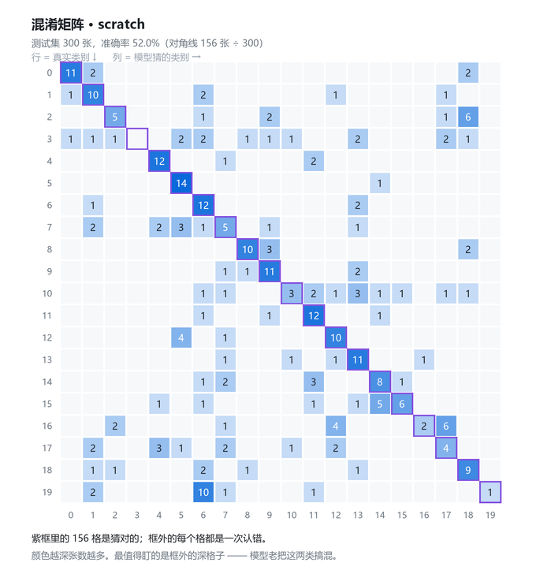
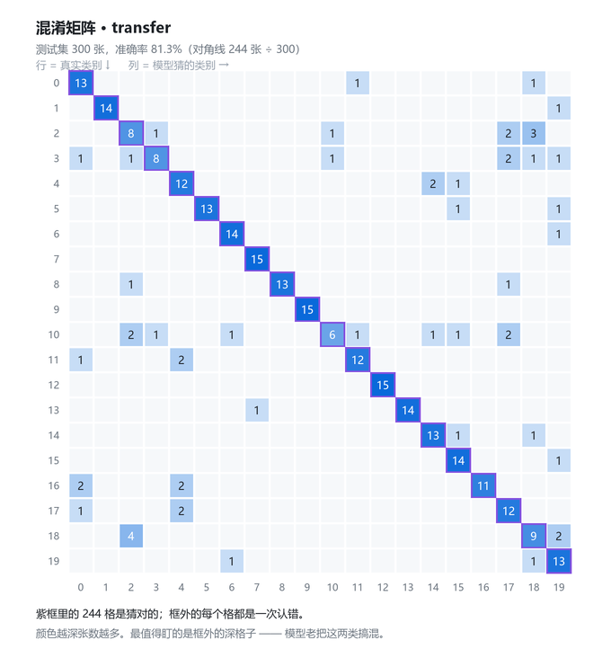
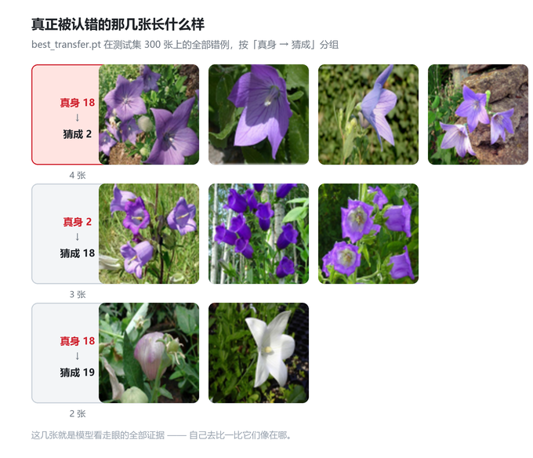

# 花卉图像识别 · PyTorch 实战

从一张花卉照片，认出它是哪一种花。这是图像分类里最经典的题目形态，
也是面试里被问得最多的一类项目（"你做过什么视觉任务？"）。

数据用 **Oxford Flowers102**：102 个花卉类别，8189 张真实照片。
这个项目用其中**前 20 类**（每类训练 20 张、测试 15 张）。

---

## 数据长什么样


Flowers102 测试集，每类取一张。类别 2 和 18（红框）是模型最容易互相认错的一对 —— 打开 [report.md](report.md) 看分析。

---

## 结果长什么样

测试集 300 张：

| 方案 | 可训练参数 | 训练 12 轮耗时 | 验证准确率 | 测试准确率 |
|---|---|---|---|---|
| scratch（自建 CNN，从零训） | 0.29 M | 约 1 分钟 | 50.0% | 52.0% |
| **transfer（ImageNet 预训练 resnet18，只训分类头）** | **0.01 M** | **约 0.5 分钟** | **85.0%** | **81.3%** |
| 瞎猜基线（20 类） | — | — | 5.0% | 5.0% |

迁移学习用**不到三十分之一的可训练参数、一半的时间**，把准确率从 52.0% 推到 81.3%。

两张混淆矩阵能看出「错」的方式不一样 —— scratch 的错误散得满图都是（还在乱猜），transfer 的错误集中在少数几对类别上（基本会了，只在最难分辨的几对上失误）：

| scratch · 测试 52.0% | transfer · 测试 81.3% |
|---|---|
|  |  |

transfer 在 300 张里错了 56 张，下面是其中最集中的几对（真身 2 和真身 18 **双向互混** —— 双向都错，说明不是模型偏向哪一方，而是这两类本身就长得像）：



完整分析见 [report.md](report.md)。

---

## 开始之前：先站对位置

**本文档里所有命令，都必须在 `project_flower` 这个文件夹里执行。**

在别的文件夹里敲 `python train.py`，Python 会去**你现在所在的文件夹**找 `train.py`，
找不到就报 `can't open file ... No such file or directory`。

```powershell
cd C:\Users\wuqian\WorkBuddy\2026-09-11-19-57-58\python-lessons\project_flower
```

进去一次，后面所有命令（`python train.py ...`、`python evaluate.py ...`）都直接敲就行。
判断自己在不在里面：提示符最后一段应该是 `\project_flower>`。

> 不想 cd 也行，把路径带上：`python project_flower\train.py --mode transfer`。
> 能跑通是因为项目里所有文件路径都是按**代码文件自己的位置**算的（`Path(__file__)`），
> 跟你在哪敲命令无关 —— 这是写代码时要养成的习惯。
> 但 cd 进去更省事，后面的命令都不用带前缀。

---

## 先说实话：这个项目里有多少是你没学过的

你学过的：PyTorch 训练循环、五步曲、过拟合与正则、DataLoader、混淆矩阵。
你没学过的（这个项目全都要用）：**卷积、特征图、图像增强、迁移学习**。

所以按老规矩应该先上一课。但你说想实战，那我们就换个学法——

**不是先上课再动手，而是先让它跑起来，遇到卡住的词再回来问我。**
每个我们撞上的新概念，我都会用你已经会的东西作类比。这是完全合法的一条路，
实际上工程师平时学新库基本都这么干。

不过我还是给你留了一把尺子：**`concepts_primer.py`**。
它不是课，没有要你背的东西，也不用按顺序看。它就是六个小实验，
每个一分钟不到，专门回答"这个词到底在干什么"：

```bash
python concepts_primer.py         # 从头看到尾（约 1 分钟）
python concepts_primer.py 4       # 只看第 4 部分
```

| 部分 | 解决哪个疑问 |
|---|---|
| 1 | 一张图在程序里到底是什么 |
| 2 | 卷积凭什么能认出图案 |
| 3 | 为什么越往里，图越小、层越厚 |
| 4 | **迁移学习为什么能成立**（本项目的心脏） |
| 5 | 数据增强到底改了什么 |
| 6 | 过拟合在图像任务里长什么样 |

**撞到卡壳的词就翻一下，没卡就不看。** 但第 4 部分建议你在做 T3 之前扫一眼，
因为它正好回答"凭什么借别人的网络能work"。

你只需要守住一条底线：**每一个数字都要知道它是怎么来的。**
跑出 87% 不是成绩，能说清"这个 87% 是在哪份数据上、跟什么基线比、波动多大"才是。

---

## 这台机器的情况（决定了项目的几个设计）

| 事实 | 影响 |
|---|---|
| **没有 NVIDIA 独显**，只有 CPU | 训练靠 CPU，所以下面四件事必须做 |
| 16 个逻辑核心 | 但读数据反而用单进程 —— 实测过了，见 `config.py` 里 `NUM_WORKERS` 那段 |
| 内存不是瓶颈 | 96×96、batch 32，这个规模跑起来毫无压力 |
| torch 2.14.0+cpu / torchvision 0.29.1 | 已装好 |

CPU 训练带来的四个适配，都写在 `config.py` 里了：

1. **图像缩到 96×96**（原图在 754×500 上下）。缩图是速度和精度的第一笔交易。
2. **先用 20 类**，不是全部 102 类。先把流程跑对，再谈规模——
   流程错了，规模越大只是错得越久。
3. **迁移学习时冻住主干**，只训最后一层。这是 CPU 上唯一现实的做法，
   也恰好是真实工作里最常用的做法。
4. **读数据先别开多进程**。Windows 上每开一个 worker 都要重新 import 一次 torch
   （6~12 秒），而这个规模的数据单进程读一轮只要 1.2 秒。开了反而更慢。
   等 `NUM_CLASSES` 改成 102 之后再开。

想跑全量时，把 `NUM_CLASSES` 改成 102 就行，代码一行都不用动。

---

## 项目结构

```
project_flower/
├── README.md          ← 你正在看的这份
├── concepts_primer.py ← 概念预备。撞到不懂的词就翻这里，不是作业
├── config.py          ← 所有参数。做实验只改这里
├── model.py           ← 两个模型：从零搭的小 CNN / 迁移学习版
├── data_utils.py      ← 数据加载、划分、图像增强
├── train.py           ← 训练主循环
├── evaluate.py        ← 评估：准确率 + 混淆矩阵 + 找错误规律
├── report_template.md ← 最后要写的 report.md 模板
├── fetch_data.py      ← 下载数据集用的（我已经跑过了，你不用管）
├── recon.py           ← 环境侦查脚本（测过才定的参数，你也不用管）
├── .vscode/           ← VSCode 配置，已经帮你指好了对的 Python
├── data/              ← 数据集落地处（已下载好）
└── outputs/           ← 模型、日志、混淆矩阵都写这里（现在是空的，从 T1 开始填）
```

---

## 三个台阶

这个项目的核心不是"跑出一个模型"，是**沿着三个台阶看准确率怎么变、并说清楚为什么**。

### 台阶 1 · 从零训练一个小 CNN

```bash
python train.py --mode scratch --epochs 12 --tag scratch
```

你会看到：训练准确率一路涨得很高，验证准确率卡在低位不动。
这是**过拟合**在图像任务里的样子（第十四课你见过它的原理，这里你会亲眼看到它有多夸张）。
记住这个数字——它是台阶 2 的对照组。

### 台阶 2 · 迁移学习

```bash
python train.py --mode transfer --epochs 12 --tag transfer
```

同一个数据、同一个任务，只是换成"借用 ImageNet 上训好的 resnet18，只训最后一层"。
准确率会跳一个台阶，而且**用的时间还更短**。

**这是本项目的核心结论**：每类只有 20 张训练图时，你不可能从零教会一个网络"什么是花瓣边缘"，
但可以直接借别人的眼睛。真实工作中 90% 的图像项目是这么起步的。

> 等一下，为什么可训练参数只剩 0.01 M（万分之一的主干参数），反而更准？
> 这个问题值得你自己先答一遍，再看 T3。

### 台阶 3 · 评估与错误分析

```bash
python evaluate.py --tag transfer
```

准确率只是一个数字。这个脚本还会告诉你：哪几类被整个放弃、
哪些类别在被互相认错。**能不能从错误里读出方向，是这一段的分水岭。**

---

## 我这边先跑过一遍了，这是你应该看到的数字

老规矩：**先给你参照，你才知道自己是算对了还是蒙对了。**
下面这份是同一台机器、同一份数据、同样的种子跑出来的。你的结果应该和它基本对得上
（差 2 个百分点以内算正常；差得远，说明中途有东西不一样，回来一起找）。

| 环节 | scratch | transfer |
|---|---|---|
| 可训练参数 | 0.29 M | **0.01 M** |
| 训练 12 轮耗时 | 1.1 分钟 | **0.5 分钟** |
| 最好的验证准确率 | 50.0% | **85.0%** |
| 测试集准确率 | 52.0% | **81.3%** |
| 瞎猜基线（20 类） | 5.0% | 5.0% |
| 相对瞎猜 | 10.4 倍 | **16.3 倍** |

scratch 一路看到的现象：训练准确率涨到 65%，验证卡在 50% 上下来回晃——
**训练集和验证集之间的缺口越拉越大，就是过拟合。**

transfer 是用一半的时间、不到三十分之一的可训练参数，把验证准确率从 50% 推到 85%。

如果 transfer 你跑出来只有 20% 上下，先别怀疑数据——**去 `config.py` 看 `LR_FINETUNE`**。
（我第一版就栽在这儿，原因写在那个参数的注释里。这是本项目最值钱的一个坑。）

---

## 你的任务

按顺序做，每一步做完告诉我结果，我们一起看。

**T1. 先把台阶 1 跑通**
- 命令：`python train.py --mode scratch --epochs 3 --tag 试探`
- 目的：确认环境、数据、代码都是活的；也顺便看看一个 epoch 要多久
- 交给我：最后那行"最好的验证准确率"是多少，以及一个 epoch 耗时

**T2. 把台阶 1 跑满，读训练曲线**
- 命令：`python train.py --mode scratch --epochs 12 --tag scratch`
- 然后打开 `outputs/history_scratch.json`，看 train_acc 和 val_acc 的走势
- 交给我：**用一句话说清 train 和 val 的差距是怎么变化的**，以及你判断这是不是过拟合、凭什么

**T3. 跑台阶 2，做对比**
- 命令：`python train.py --mode transfer --epochs 12 --tag transfer`
- 交给我：一张两行的对比表（scratch vs transfer 的验证准确率、耗时、可训练参数量），
  以及一句结论——**为什么同样的数据，结果差这么多**

**T4. 做一次参数实验**
- 自己选一个参数改（`IMG_SIZE`、`BATCH_SIZE`、`LR`、`EPOCHS` 都行），跑一遍，和基线对比
- 交给我：你改了什么、结果变了多少、你认为这个变化说明了什么
- 提示：改一个就好。一次改三个，就说不清是谁的功劳了

**T5. 错误分析 + 写报告**
- 跑 `evaluate.py`，找出最容易认错的类别对
- 写一份 `report.md`（我给了模板 `report_template.md`），
  把整个项目讲成一个故事：怎么做的、结果怎样、错在哪、下一步会怎么做

---

## 这一路上你会撞到的词（先给一句话，撞到了再来细讲）

| 词 | 一句话 |
|---|---|
| 卷积 | 用一个小窗口在图上滑动，扫出局部图案（边缘、纹理、花瓣形状） |
| 通道 | 特征图的"第几层抽象"，3 通道是红绿蓝，后面会变成 32、64、128 |
| 特征图 | 卷积的输出，可以理解为"网络眼里的这张图长什么样" |
| MaxPool | 每 2×2 取最大，把图缩小一半。让后面的层看到更大的范围 |
| BatchNorm | 把每一层的输出重新调成合适的刻度，训练更稳更快 |
| Dropout | 训练时随机掐掉一部分神经元，逼网络别太依赖某几个 |
| 全局平均池化 | 不管特征图多大，都压成一个数。省掉一坨全连接参数 |
| 迁移学习 | 借用别人在别的任务上训好的网络，只换最后一层 |
| 冻结 | 把主干参数的 requires_grad 关掉，训练时不更新它们 |
| 数据增强 | 训练时随机翻转、旋转、裁剪，等于凭空造出更多变体 |
| 归一化 | 把像素值调成固定刻度。用的均值和标准差必须和预训练时一致 |
| BN 统计量 | BatchNorm 记在心里的"这一层的均值方差"。它也会被训练改动 |
| 分类头 | 网络的最后一层，负责把特征翻译成"这是第几类" |

---

## 几个已经帮你避开的坑

前四条是工程习惯，后两条是**迁移学习专属的、我自己先踩过一遍的坑**。

- **评估时的变换不能带随机**。同一张图两次评估结果必须一样，
  否则误差比你要比较的差距还大。（`data_utils.py` 里分了两套 transform）
- **损失累加要乘 batch 里的实际张数**。最后一个 batch 常常不满，
  直接对 loss 取平均会被它带偏。（`train.py` 的 `run_epoch` 里处理了）
- **验证/测试必须 no_grad**。否则白白建计算图，又慢又吃内存。
- **DataLoader 的随机增强只在训练集上开**。

- **坑一：用了预训练，学习率反而不能调小。**
  直觉是"预训练模型已经很好了，轻轻推一下就行"，于是沿用小学习率 1e-4。
  但冻住主干之后，真正在学的只有那个**随机初始化的分类头**——它一开始是瞎的，
  需要大步子。这不是"稳一点"，是**根本没开始走**。

  这个坑你可以自己复现：把 `config.py` 的 `LR_FINETUNE` 改回 `1e-4`，
  命令不变跑一遍，验证准确率会掉到 **18.8%**；改回 `1e-3` 是 **85.0%**。

- **坑二：冻住主干之后，BatchNorm 的统计量也要一起冻。**
  这个更隐蔽。`freeze_backbone` 只关掉了参数的 `requires_grad`，
  但 BatchNorm 在训练模式下还有第二件事：用当前 batch 的均值方差，
  去更新它自己记住的 `running_mean / running_var`。
  主干那些统计量是拿上千万张 ImageNet 图片喂出来的，
  你现在拿几百张花卉图去覆盖，等于把人家调好的刻度擦掉重写。
  **现象是：明明用了预训练，效果还不如随机初始化。**

  更麻烦的是——你已经调用 `model.eval()` 检查过了，评估时它是对的。
  错的是**训练时**：`model.train()` 会把所有子模块一并设成训练模式，
  包括那些已经被冻住的。所以要在每一轮训练开始后，再把它们按回去。
  `model.py` 里的 `lock_frozen_batchnorm()` 就是干这个的，
  `train.py` 的 `run_epoch` 每次训练前都会调一次。

  一句话记住：**参数被冻结的层，统计量也应该冻住。**

我当初是靠一张 2×3 的对照实验才把这两个原因分开的（学习率 × 有没有锁 BatchNorm）：

| 学习率 | 锁了 BN 统计量？ | 最好的验证准确率 |
|---|---|---|
| 1e-4 | 否 | 12.5% |
| 1e-4 | 是 | 26.2% |
| 1e-3 | 否 | 71.2% |
| **1e-3** | **是** | **86.2%** |
| 1e-2 | 否 | 77.5% |
| 1e-2 | 是 | 82.5% |

（这张表的轮数和数据切分跟最终项目略有出入，所以 86.2% 和上面那份 85.0%
不会完全相等——实验设置一旦变了，数字就不该指望逐位对齐。
**"复现"指的是结论一致，不是小数点后一致。**）

看这张表最该注意的是：**两个坑是会叠加的。**
只修学习率是 71.2%，只修 BN 是 26.2%，两个都修才到 86.2%。
如果一个一个单独修，你会以为"BN 那个改动只值 8 个点"——那就把最要命的那个原因放走了。

## 环境备忘

### 在 VSCode 里跑（推荐）

项目里带了一份 `.vscode/settings.json`，已经帮你把解释器指对了。
**直接在 VSCode 的终端里敲 `python train.py ...` 就行**，不用记长路径。

打开方式：VSCode → 文件 → 打开文件夹 → 选 `project_flower`。
然后按 `` Ctrl+` `` 调出终端，确认路径是 `project_flower` 就能开跑。

### 这里有个坑，先跟你说清楚

你机器上装了不止一个 Python：

| 哪一个 | 有没有 torch |
|---|---|
| PATH 上那个 `python`（工具链自带，3.13.12） | **没有** |
| 项目需要的那一个（3.13.14） | **有**，torch 2.14.0+cpu、torchvision 0.29.1+cpu |

所以在别的地方（比如系统自带的 PowerShell 窗口）直接敲 `python`，
很可能会报 `ModuleNotFoundError: No module named 'torch'`。
**这不是没装，是走错了环境。** 真要手动跑，用完整路径：

```
C:\Users\wuqian\.workbuddy\binaries\python\envs\default\Scripts\python.exe train.py --mode scratch --epochs 3 --tag 试探
```

### 其他

- 数据：`data/flowers-102/`（已下载，330 MB）
- 没有 GPU，所有 `.to(device)` 都是 CPU。**别去写 `.cuda()`，会直接报错。**
- 这套代码里的中文输出在 Windows 终端偶尔会乱码；
  `.vscode/settings.json` 里已经设了 UTF-8，如果还是乱，在终端敲 `chcp 65001`。
